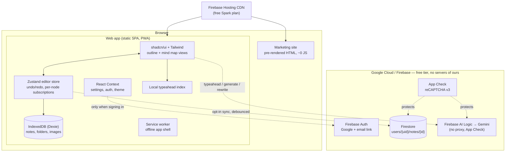

# noodl

**noodl** is a playful, local-first mind-mapping app for the web, modelled on the UX of the iOS app *MindNote – Mind Map & Notes*: every note is both an **outline** and a **mind map**, every node has **AI typeahead**, and everything works **offline, free, with no account**. Sign in with Google only if you want sync across devices.

```
apps/app         The web app (Next.js static export, served at /app)
apps/marketing   The marketing site (pre-rendered, SEO-first, served at /)
packages/tokens  Shared design tokens (shadcn / Tailwind v4 CSS variables)
packages/brand   noodl brand kit: logos, app icons, favicons, social preview
design/          Design spec (DESIGN.md), tokens and mockups
```

## Architecture



**Local-first.** Notes are read and written in IndexedDB; the network is never on the critical path. Sync is a mirror, not the source of truth.

**No backend.** Both sites are static files on Firebase Hosting. The browser talks to Firebase directly; Firestore security rules (`firestore.rules`) replace an API, and Firebase AI Logic lets the browser call Gemini without exposing a key, so there is no proxy to run.

### Why these choices

| Decision | Reason |
|---|---|
| Next.js `output: "export"` | Pure static files → free hosting, CDN everywhere, no cold starts. |
| Zustand for the editor, Context for app state | A map can have hundreds of typeahead nodes. With Context every keystroke re-renders every consumer; with Zustand each node subscribes to its own slice. Settings/auth/theme change rarely, so they stay in Context. Redux would add weight without benefit. |
| Firebase Auth (GCP) | Free for email/Google sign-in up to 50k MAU; phone/SMS (paid) deliberately not used. |
| Firestore, one document per note | Opening a note costs 0 reads (it's local); syncing an edit is 1 write; listeners only query docs changed since the last pull. |
| Firebase AI Logic instead of a proxy | Gemini Developer API free tier works on the Spark plan; no Cloud Function (which needs the paid Blaze plan). |
| Firebase Hosting instead of Vercel | Vercel's free Hobby plan is non-commercial only; Firebase Hosting is free for commercial use and keeps everything in one GCP project. |
| Images stay local | Cloud Storage for Firebase now requires the Blaze plan. Images are compressed (WebP, ≤1280px) and kept on the device. |

## Cost: what keeps it at ~$0

| Service | Free allowance (Spark) | How we stay under it |
|---|---|---|
| Hosting | 10 GB storage, 360 MB/day transfer | Static, compressed, immutable-cached assets; marketing pages ship ~no JS. |
| Auth | 50k monthly active users (email/Google) | Guests never touch Auth; no SMS. |
| Firestore | 50k reads, 20k writes, 20k deletes per day; 1 GiB | Sync is opt-in, debounced (3 s), batched, only dirty notes; incremental listener. |
| Gemini (AI Logic) | Free-tier rate limits per project | Debounce (350 ms), abort on keystroke, LRU cache, client limit of 12 suggestion calls/min, 60 s back-off on 429, local fallback. |

Spark has **hard caps**: if a quota is hit, that feature pauses until the next cycle — you never get a bill. If you outgrow it, upgrade to Blaze with a budget alert.

## Getting started

```bash
pnpm install
pnpm dev                 # app on http://localhost:3000/app
pnpm dev:marketing       # marketing site
pnpm test                # unit tests (tree ops, layout, import/export, typeahead)
pnpm lint
./scripts/build-site.sh  # builds both into dist/ (marketing at /, app at /app)
```

Without any environment variables the app runs fully local: no sign-in, no sync, typeahead uses your own notes.

## Turning on Firebase (sign-in, sync, AI)

1. Create a Firebase project (keep it on the **Spark** plan).
2. **Authentication** → enable **Google** and **Email link (passwordless)**. Add your hosting domain to *Authorized domains*.
3. **Firestore** → create a database (production mode), then deploy rules: `firebase deploy --only firestore`.
4. **AI Logic** → *Get started* → choose **Gemini Developer API** (free tier). Check the current free model id in Google AI Studio and set `NEXT_PUBLIC_GEMINI_MODEL` (default `gemini-3.1-flash-lite`).
5. **App Check** → register the web app with **reCAPTCHA v3**, put the site key in `NEXT_PUBLIC_RECAPTCHA_SITE_KEY`, then **enforce** App Check for Firestore and AI Logic (required for AI Logic from 2 Nov 2026).
6. Copy `apps/app/.env.example` to `apps/app/.env.local` and fill in the web app config from *Project settings*.
7. `cp .firebaserc.example .firebaserc`, set your project id, then `./scripts/build-site.sh && firebase deploy`.

### CI/CD

- `.github/workflows/ci.yml`: install, lint, test, build, Lighthouse CI on every push/PR.
- `.github/workflows/deploy.yml`: deploys `main` to Firebase Hosting. Set repository **variables** `FIREBASE_PROJECT_ID`, `NEXT_PUBLIC_SITE_URL`, `NEXT_PUBLIC_FIREBASE_*`, `NEXT_PUBLIC_RECAPTCHA_SITE_KEY`, optional `NEXT_PUBLIC_GEMINI_MODEL`, and the **secret** `FIREBASE_SERVICE_ACCOUNT`.

## Features

- Outline ↔ mind map on the same note, instant switch (`⇧⌘M`)
- AI typeahead on every node: ghost text (Tab / → to accept), up to 5 suggestions (↑ ↓, Enter), ideas for empty nodes, local fallback offline / rate-limited / AI off
- Generate a map from a prompt, summarize pasted text into a map, rewrite a node, expand a node into ideas
- Keyboard-first: Tab child, Enter sibling, Space edit, arrows to navigate, ⌥↑↓ reorder, ⌥0–3 levels, ⌘Z/⇧⌘Z, copy/paste branches as indented text
- Drag nodes to reparent (map) or reorder (outline); pan, pinch/ctrl-wheel zoom, fit, double-click to reset
- Node types: text, link, image (local), table
- Map styles: Ballpoint (curved), Elbow, Index card; light/dark themes
- Library: folders, search across notes and nodes (⌘K), templates, recycle bin (30 days), duplicate, move
- Export PNG, JPEG, PDF, Markdown, HTML, plain text, JSON; import Markdown/JSON (also drag-and-drop); full backup/restore
- Works offline (service worker + IndexedDB); guest mode by default; Google / email-link sign-in for sync with conflict copies

## Not yet built (good next steps)

- Per-note version history / snapshots (design §4.10); today there's undo, the recycle bin, conflict copies and full backups
- Mobile keyboard accessory bar with suggestion chips (design §8); mobile currently uses the same dropdown
- Multi-select and marquee selection; "Sketch" map style
- Firestore rules unit tests with the emulator
