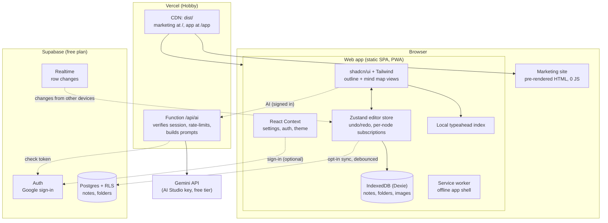

# noodl

**noodl** is a playful, local-first mind-mapping app for the web, modelled on the UX of the iOS app *MindNote – Mind Map & Notes*: every note is both an **outline** and a **mind map**, every node has **AI typeahead**, and everything works **offline, free, with no account**. Sign in with Google to sync across devices and to use AI suggestions.

```
apps/app             The web app (Next.js static export, served at /app)
apps/marketing       The marketing site (pre-rendered, SEO-first, 0 KB JS, served at /)
api/                 Vercel Function: /api/ai (Gemini, signed-in users only)
supabase/migrations  Postgres schema + row-level security for sync
packages/tokens      Shared design tokens (shadcn / Tailwind v4 CSS variables)
packages/brand       noodl brand kit: logos, app icons, favicons, social preview
tests/               supabase-rls (PGlite) and api function tests
design/              Design spec (DESIGN.md), tokens and mockups
```

## Architecture



**Local-first.** Notes are read and written in IndexedDB; the network is never on the critical path. Sync is a mirror, not the source of truth.

**Almost no backend.** Both sites are static files on Vercel's CDN. The browser talks to Supabase directly; Postgres row-level security (`supabase/migrations`) replaces an API. The only server code is one small function, `/api/ai`, which keeps the Gemini key secret, accepts only signed-in users, builds the prompts and rate-limits per user. No Google Cloud project to manage.

### Why these choices

| Decision | Reason |
|---|---|
| Next.js `output: "export"` | Pure static files → free hosting, CDN everywhere, no cold starts. |
| Zustand for the editor, Context for app state | A map can have hundreds of typeahead nodes. With Context every keystroke re-renders every consumer; with Zustand each node subscribes to its own slice. Settings/auth/theme change rarely, so they stay in Context. Redux would add weight without benefit. |
| Supabase Auth | Free up to 50k monthly active users; Google sign-in only (email links can be added later). |
| Supabase Postgres, one row per note (jsonb) | Opening a note costs 0 reads (it's local); syncing an edit is 1 upsert; pulls ask only for rows with a newer server timestamp; Realtime streams changes while the app is open. |
| Gemini behind a Vercel Function | The key never reaches the browser; only signed-in users; prompts built server-side, so the endpoint isn't a general Gemini proxy. |
| Vercel | One project serves the static sites and the function. **The free Hobby plan is for personal, non-commercial use**; a commercial launch needs Pro. |
| Images stay local | Keeps storage at zero; images are compressed (WebP, ≤1280px) and kept on the device. |

## Cost: what keeps it at ~$0

| Service | Free allowance | How we stay under it |
|---|---|---|
| Vercel Hobby | 100 GB transfer, 1M function invocations, 4 active-CPU hours / month | Static, immutable-cached assets; marketing pages ship 0 JS; the AI function mostly waits on Gemini (I/O wait isn't active CPU). |
| Supabase Free | 50k MAU, 500 MB database, 5 GB egress; **pauses after 1 week without activity** | Guests never touch Supabase; sync is opt-in, debounced (3 s), only dirty rows, incremental pulls. |
| Gemini API (AI Studio key, no billing) | Free-tier rate limits per minute/day | Signed-in only; client debounce (adjustable 150–600 ms), abort on keystroke, LRU cache, 12 suggestion calls/min client-side; server limits of 30 suggestions/min, 10 generations/min, 600 requests/day per user (best effort per instance); 60 s back-off on 429; local fallback. |

On the free Gemini tier, Google's terms allow it to use prompts and responses to improve its products; the privacy page says so. Use a paid key to avoid that.

## Getting started

```bash
pnpm install
pnpm dev                 # app on http://localhost:3000/app
pnpm dev:marketing       # marketing site on http://localhost:3001
pnpm test                # app unit tests + Supabase RLS tests (PGlite) + AI function tests
pnpm lint
pnpm build               # builds both into dist/ (marketing at /, app at /app)
pnpm start               # serves dist/ + /api/ai like Vercel, on http://localhost:4320
```

Without environment variables the app runs fully local: no sign-in, no sync, typeahead uses your own notes. Copy `.env.example` to `.env.local` (repo root) to enable Supabase and AI locally.

## Setting up Supabase + Vercel

**Supabase**
1. Create a project at supabase.com (free plan).
2. *SQL editor* → run `supabase/migrations/20261019000000_noodl_sync.sql` (or `supabase db push` with the CLI). It creates `notes` and `folders`, row-level security, server timestamps and adds both tables to Realtime.
3. *Authentication → Sign In / Providers → Google*: copy the **Callback URL** shown there. In Google's console (console.cloud.google.com → Google Auth Platform): set Branding + Audience (External), add the `openid` scope, then *Clients → Create client → Web application* with Authorized JavaScript origins `https://YOUR-DOMAIN`, `http://localhost:4320`, `http://localhost:3000` and Authorized redirect URI = the Supabase callback URL. Paste the Client ID + secret into Supabase's Google provider and enable it.
4. *Authentication → URL Configuration*: Site URL = your Vercel URL; add `https://YOUR-DOMAIN/app/` and `http://localhost:4320/app/`, `http://localhost:3000/app/` to Redirect URLs.
5. *Project Settings → API*: copy the Project URL and the **publishable** key.

**Gemini key**: create an API key at https://aistudio.google.com/apikey (no billing account → free tier).

**Vercel**
1. *Add New → Project* → import `Sashank-Deb/Noodl`. Root directory: the repo root. `vercel.json` sets the build (`./scripts/build-site.sh`), output (`dist`) and the `/api/ai` function.
2. Environment variables (Production + Preview): `NEXT_PUBLIC_SUPABASE_URL`, `NEXT_PUBLIC_SUPABASE_PUBLISHABLE_KEY`, `GEMINI_API_KEY`, optional `GEMINI_MODEL`, `NEXT_PUBLIC_SITE_URL` (your production URL).
3. Deploy. Every push to `main` deploys to production; pull requests get preview URLs (add their domains to Supabase redirect URLs if you test sign-in there).

### CI

`.github/workflows/ci.yml`: install, lint, all tests, build and Lighthouse CI on every push/PR. Deploys are handled by Vercel's GitHub integration.

## Features

- Outline ↔ mind map on the same note, instant switch (`⇧⌘M`); right-side or balanced map layout
- AI typeahead on every node: ghost text (Tab / → to accept), up to 5 suggestions (↑ ↓, Enter), ideas for empty nodes, local fallback offline / rate-limited / AI off; adjustable delay and Tab behaviour; suggestion chips above the keyboard on phones
- Generate a map from a prompt, summarize pasted text into a map, rewrite a node with a preview (Replace / Insert below / Discard, preset or custom instruction), expand a node into ideas
- Keyboard-first: Tab child, Enter sibling, Space edit, arrows to navigate, ⌥↑↓ reorder, ⌥0–3 levels, ⌘J AI, ⌘. focus mode, ⌘Z/⇧⌘Z, copy/paste branches as indented text
- Drag nodes to reparent (map) or reorder (outline); pan, pinch/ctrl-wheel zoom, fit, double-click to reset; large maps render only what's on screen
- Node types: text, link, image (local), table (editable inline)
- Map styles: Ballpoint (curved), Elbow, Index card; light/dark themes
- Library: folders, search across notes and nodes (⌘K), templates, recycle bin (30 days), duplicate, move
- Version history: last 20 snapshots per note on the device, restore in place or as a copy
- Export PNG, JPEG, PDF, Markdown, HTML, plain text, JSON; import Markdown/JSON (also drag-and-drop); full backup/restore
- Works offline (service worker + IndexedDB); guest mode by default; Google / email-link sign-in (Supabase) for sync and AI; side-by-side conflict review

## Run it locally

- macOS: double-click `Start noodl.command` (serves the production build at http://localhost:4320/app/) or `Dev noodl.command` (hot reload at http://localhost:3000/app/). See `TESTING.md` for a manual test checklist.
- Anywhere: `pnpm install && pnpm build && pnpm start`

## Not yet built (good next steps)

- Multi-select and marquee selection; "Sketch" / "Monochrome" map styles
- Redraw design/mockups.html in the brand colours (layout is still accurate)
